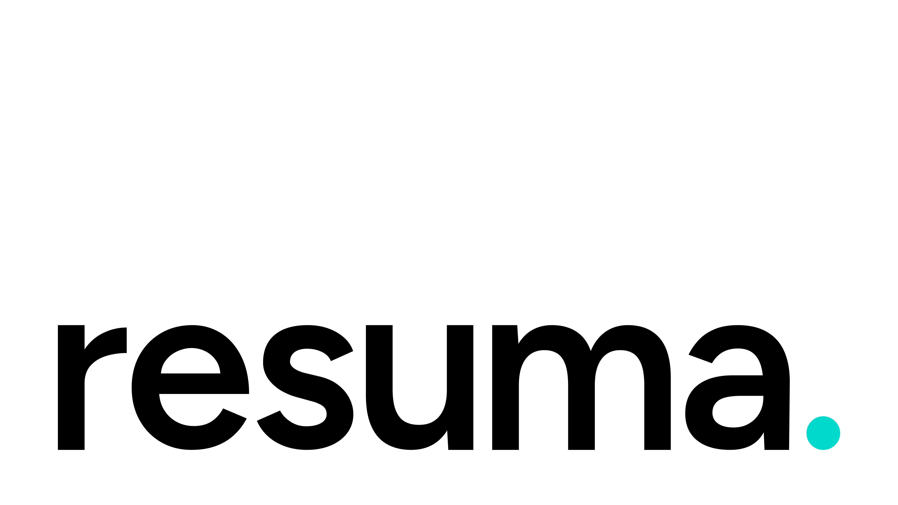

# 


Resuma is an open-source desktop application for building beautiful, professional resumes using local AI models. With the default local setup, your data never leaves your device.

Powered by Tauri, Rust, React (TSX), and llama.cpp, Resuma brings the power of private AI directly to your desktop, ensuring fast performance and complete privacy. If you would rather use a model you already host or pay for, you can point it at Ollama, LM Studio, or a cloud API with your own key instead.

> ⚡ **Local by default**: Your resumes never reach an external server unless you configure one yourself.

> 🔐 **Encrypted on disk**: Resumes and settings are encrypted, with a recovery key and password-protected backups.

> ⚡ **Cross-platform**: Works on Windows, macOS, and Linux, on x64 and ARM64.

## 💖 Support

[](https://www.buymeacoffee.com/nikolchaa)

## 🔧 Features

- ✍️ Offline AI resume writing, or no AI at all: everything except the AI actions works without a model
- 📂 Full local data storage (no external servers)
- 🔐 Resumes and settings encrypted on disk, with a recovery key and encrypted backups (see [Security](#-security))
- ✨ Elegant onboarding and user experience
- 🎯 Tailoring to a job ad: AI suggests entries to leave out and new wording for the rest, and you apply, discard, or undo each suggestion
- 🧭 Optional job matching model that makes tailoring faster and more consistent with local AI
- 🔎 Keyword coverage check against a job ad, with or without AI
- 🧩 Simple, Design, and Source editor modes, from forms only to editing the resume and its template as Resuma Markup (`.rsm`)
- 📄 Four built-in templates (Professional, Modern, Compact, and the two-column Sidebar), eight fonts for Latin and Cyrillic text, and your own template library
- 🖼️ Live PDF preview with page splitting, and PDF and plain-text export
- ⚙️ Advanced model configuration (mmap, mlock, gpu_layers, context size, etc.)
- 🤗 Live model discovery: search thousands of GGUF models on Hugging Face, pick a quantization, and download it in-app
- 👨‍💼 Customizable personal information, education, projects, skills, and more
- 🛠️ Supports multiple local models and hardware backends (CPU, CUDA, HIP, Vulkan, Metal, OpenCL)
- ☁️ Optional cloud APIs (Anthropic, OpenAI, Gemini, DeepSeek, Kimi, or a custom endpoint) using your own key
- 🖧 Optional local model hosts (Ollama, LM Studio, or any OpenAI-compatible endpoint)
- 🔌 Optional MCP connection so other AI apps on your computer can read your resumes, check templates and suggest changes you approve (off by default, token-protected, personal details hidden unless you share them)
- 🚀 Cross-platform support: Windows, macOS, and Linux, on x64 and ARM64
- 🌍 Interface in English, Serbian, Spanish, Russian, French, German, and Portuguese
- 🔍 Search across your resumes
- 🎨 Theming support with light/dark modes
- 🧱 Modular and extendable architecture for future features
- 🧑‍💻 Developer-friendly setup with clear code structure and CLI integration

## 🔐 Security

Resuma keeps your data on your computer and protects it there:

- **Encrypted at rest**: resumes and settings are encrypted with AES-256-GCM. The key is created on your computer the first time Resuma runs and kept in your operating system's credential manager (Windows Credential Manager, macOS Keychain, or the Linux Secret Service), so Resuma opens your data without asking for a password. Where no credential manager is reachable, such as a headless Linux setup, the key goes into an encrypted file instead, and Resuma tells you so.
- **Recovery key**: shown once when encryption is set up, and again on request in **Settings → App Settings → Data protection**. With it, your data folder opens on another computer, or here if the credential manager ever loses the key.
- **Encrypted backups**: export the resumes you pick and, if you want, your profile and settings to one file, protected by a password you choose (Argon2id). Backups are the only way resumes and settings leave Resuma, and they are always encrypted.
- **API keys in the credential manager**: keys for cloud AI providers are never written to the settings file or to backups.
- **No telemetry or analytics**: nothing is uploaded or synced. The only request Resuma makes on its own is an update check at start-up, which carries nothing about you and can be turned off.

Encryption protects copies of your data folder, such as backups, cloud-synced folders, or a lost disk. It doesn't protect against programs running under your own account, which can unlock the data the same way Resuma does. The [Privacy Policy](./PRIVACY.md) has the details.

## 📦 Installation

### Option 1: Official Installer (Recommended)

Visit [resuma.download](https://resuma.download) or the [GitHub Releases page](https://github.com/nikolchaa/resuma/releases) to download the latest stable version.

### Option 2: Bleeding Edge (Development Builds)

Clone and run the latest development version directly from GitHub:

```bash
git clone https://github.com/nikolchaa/resuma.git
cd resuma
npm install
npm run tauri dev
```

> **Note:** Development builds may contain experimental features. Make sure you have Rust and Tauri prerequisites installed. See the [Tauri setup guide](https://v2.tauri.app/start/prerequisites/).

## 🔒 License

This project is licensed under the [GNU GPLv3 License](./LICENSE).

```text
Resuma - AI-Powered Resume Builder
Copyright (C) 2025  Nikola Ranđelović

This program is free software: you can redistribute it and/or modify
it under the terms of the GNU General Public License as published by
the Free Software Foundation, either version 3 of the License, or
(at your option) any later version.

This program is distributed in the hope that it will be useful,
but WITHOUT ANY WARRANTY; without even the implied warranty of
MERCHANTABILITY or FITNESS FOR A PARTICULAR PURPOSE. See the
GNU General Public License for more details.

You should have received a copy of the GNU General Public License
along with this program. If not, see <https://www.gnu.org/licenses/>.
```

"Resuma™" and the Resuma™ logo are trademarks of Nikola Ranđelović. Please see the [Trademark Policy](./TRADEMARK.md) for details.

## 📧 Contact

Questions, ideas, or contributions? Reach out to us at [contact@nikolchaa.com](mailto:contact@nikolchaa.com).

## 📄 Legal

- [Terms of Service](./TERMS.md)
- [Privacy Policy](./PRIVACY.md)
- [Third-Party Software Disclosure](./THIRD_PARTY.md)
